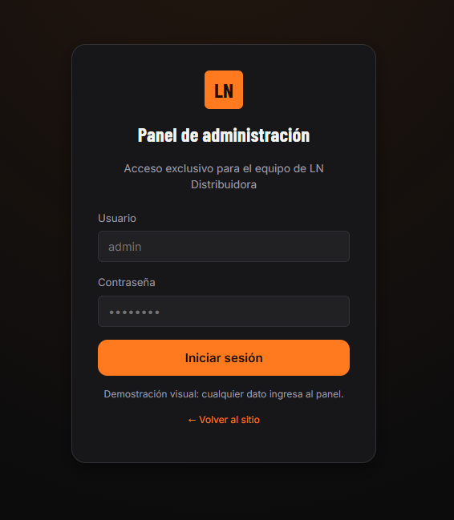

# Catálogo digital con pedidos por WhatsApp para LN Distribuidora

Para fines demostrativo del producto al cliente, se realizó esta demo para que el cliente tenga contacto con una aproximación del producto y asi exponer sus necesidades de lo que espera que haga la aplicacion.

## Qué es

Es un catálogo online propio de LN Distribuidora, donde los comercios ven los productos y arman su lista de pedido para enviártela por WhatsApp. No es una tienda con pagos: no hay cobro, ni envíos, ni checkout dentro del sitio. El objetivo es que dejes de pasar listas de precios por chat y recibas consultas ya ordenadas.

Así lo usa un cliente:

1.  Entra al sitio y busca por nombre, categoría o marca.
2.  Mira la foto, el precio y la disponibilidad de cada producto.
3.  Agrega lo que necesita a "Mi pedido", con las cantidades.
4.  Toca "Consultar pedido por WhatsApp" y te llega el mensaje armado con toda la lista.

## Qué incluye

Incluye todo lo necesario para publicar y mantener el catálogo sin depender de nadie más.

-   Sitio web público, adaptado a computadora, tablet y celular.
-   Buscador, filtros por categoría y marca, y orden por precio o nombre.
-   Ficha de cada producto con foto ampliable, precio, marca, presentación y disponibilidad.
-   Lista "Mi pedido" que se conserva aunque el cliente recargue la página.
-   Consulta por WhatsApp de un producto o de todo el pedido, con el mensaje ya redactado.
-   Panel privado, con usuario y contraseña, para cargar productos, cambiar precios y subir fotos.
-   Categorías que se pueden editar desde el mismo panel.
-   Personalización con tu logo, datos de contacto y horarios.

## Cómo se administra día a día

El catálogo se administran desde el panel privado, sin tocar código.

-   **Cargar un producto:** se completan nombre, categoría, marca, presentación, precio, estado y foto.
-   **Cambiar un precio o una descripción:** se edita el producto y se guarda; el sitio se actualiza al instante.
-   **Marcar "Sin stock":** el producto se sigue viendo, pero no se puede agregar al pedido.
-   **Desactivar un producto:** deja de verse en el sitio sin borrarlo, y se puede volver a activar.
-   **Recibir pedidos:** llegan a tu WhatsApp como mensajes con la lista armada. El sitio no guarda pedidos.

## Pantalla principal

## Login Admin (Usuario: Admin ; Contraseña: admin)

## Dashboard Admin

